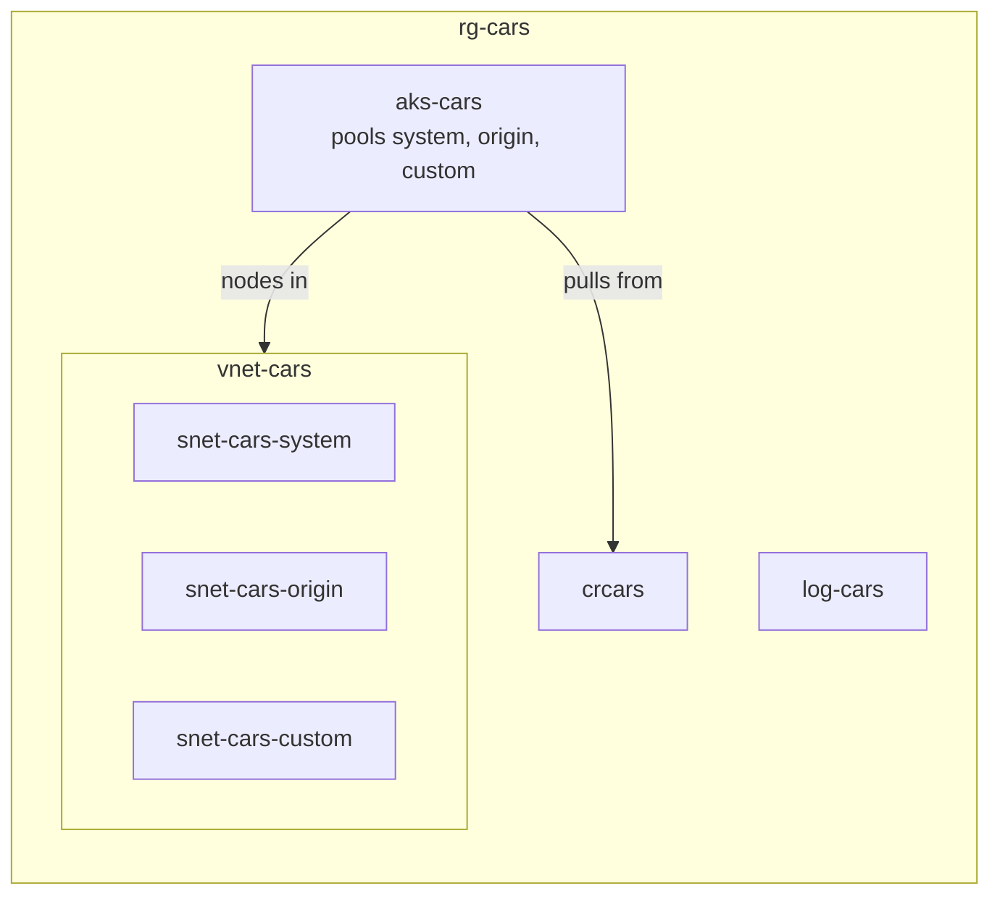

<!--
@license
Copyright (c) rljson

Use of this source code is governed by terms that can be
found in the LICENSE file in the root of this package.
-->

# cars-infra

English | [Deutsch](README.de.md)

The Azure resources of the cars application, an example app built on
Rljson: Node.js scripts to bootstrap, deploy and test, and one Bicep
component per resource, among them the Kubernetes cluster.

## Motivation

- Every Azure resource of cars is described in git, so it can be rebuilt
  from this repo alone
- Each deploy shows a what-if first and applies only after a yes
- What runs on these resources lives in
  [cars-deployment](https://github.com/cars-world/cars-deployment), so a
  change to an image never touches the Azure resources

## Layout

| Path                     | Content                                                                  |
| ------------------------ | ------------------------------------------------------------------------ |
| `bootstrap/bootstrap.js` | Run once: registers the resource providers, creates the group `rg-cars`  |
| `deploy.js`              | Deploys one component or all of them into `rg-cars`                      |
| `test.js`                | Runs the unit tests of `lib` and builds every Bicep and parameter file   |
| `lib`                    | Settings and checks shared by the scripts, with their tests              |
| `bicep`                  | One folder per component: `main.bicep` and `<component>.bicepparam`      |

All resources live in one resource group `rg-cars` in Germany West
Central and serve the stages `dev`, `test` and `prod` together: one
Kubernetes cluster `aks-cars`, one registry, one network and one Log
Analytics workspace, and a Logic App that stops the cluster every
evening. What separates the stages and the
sides inside the cluster, namespaces, quotas and network policies, is not
part of this repo.



## Usage

Install [Node.js](https://nodejs.org) 22 or later, the
[Azure CLI](https://learn.microsoft.com/cli/azure/install-azure-cli) and
its Bicep CLI once:

```bash
az bicep install
```

Sign in with your own Entra account first; the operator needs the group
`cars-admins` or `cars-operators`.

```bash
az login
az account set --subscription cars
```

Prepare the subscription once:

```bash
node bootstrap/bootstrap.js
```

Deploy all components in order; each shows its what-if first and nothing
changes before your yes:

```bash
node deploy.js all
```

Deploy one component, or only show the changes:

```bash
node deploy.js network
node deploy.js network --what-if
```

`--yes` applies after the what-if without asking, for runs without a
terminal. The scripts check the active subscription first. Every resource
gets the tag `techresponsibility` with the signed-in user. The component
`aks` gives the groups `cars-admins` and `cars-operators` admin rights in
the cluster; `deploy.js` looks up their object IDs by name.

There is no DNS zone: the apps use the free Azure names under
`germanywestcentral.cloudapp.azure.com`, carried by the public IPs of
their Gateways, which are not part of this repo.

Sign in to the cluster with your Entra account:

```bash
az aks get-credentials --resource-group rg-cars --name aks-cars
kubelogin convert-kubeconfig -l azurecli
```

The component `aks-schedule` stops the cluster every day at 20:00
Berlin time. Start it by hand before you work with it; it takes a few
minutes:

```bash
az aks start --resource-group rg-cars --name aks-cars
```

The component `github` lets GitHub Actions sign in to Azure through
OpenID Connect, without a stored secret: `id-cars-github-build` for the
workflows on `main` of the repos in `buildRepos`, which push images to
`crcars` and read the Key Vault `kv-cars-github`, and
`id-cars-github-scan` for the pull requests of the repos in `scanRepos`,
which only pull. The groups `cars-admins` and `cars-operators` may write
secrets into the Key Vault, e.g. the private key of a GitHub App:

```bash
az keyvault secret set --vault-name kv-cars-github \
  --name <secret> --file <path-to-key>
```

## Test

Before each commit:

```bash
node test.js
```

## Limitations

- No CI yet: operators deploy by hand from their machine; the GitHub
  Actions workflows will call the same scripts
- No databases, storage or workload identities of the apps yet
- The cluster stops every evening at 20:00 and runs only after a manual
  `az aks start`, so the apps of every stage, prod included, are offline
  until then. Running day and night, four nodes, two of them in the pool
  `system`, cost about 120 to 270 USD a month at list prices; stopped, only the disks, the public IP
  and the load balancer cost, about 20 USD a month. The control plane is
  in the Free tier, without an uptime SLA

## Status

| Component            | Resources                                                         | Deployed |
| -------------------- | ----------------------------------------------------------------- | -------- |
| `log-analytics`      | `log-cars`                                                        | yes      |
| `container-registry` | `crcars`                                                          | yes      |
| `network`            | `vnet-cars`, `snet-cars-<pool>`, `nsg-cars-<pool>`                | yes      |
| `aks`                | `aks-cars`, `id-aks-cars`, node resource group `rg-cars-aks`      | yes      |
| `aks-schedule`       | `logic-aks-cars-stop`                                             | yes      |
| `github`             | `id-cars-github-build`, `id-cars-github-scan`, `kv-cars-github`   | no       |
